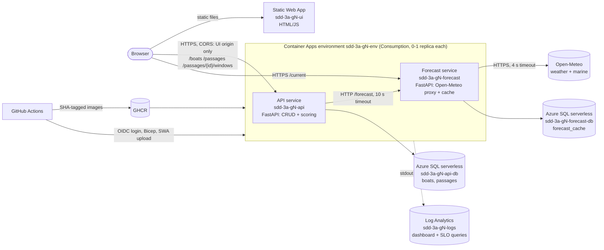

# Sailing Passage Go/No-Go Planner

<!-- TODO(team): README wording -->

Save a boat with the wind, gust and wave limits it can safely sail in, and a passage (start, end,
planned speed). The planner pulls the marine forecast from Open-Meteo and shows every hourly
departure in the next three days as **GO** or **NO-GO**, with the reason: which limit failed, by
how much, and when.

**Live:** UI `TODO(team): https://<sdd-3a-gN-ui>.azurestaticapps.net` ·
API `TODO(team): https://<sdd-3a-gN-api>.<env>.azurecontainerapps.io/docs` ·
Forecast `TODO(team): https://<sdd-3a-gN-forecast>.<env>.azurecontainerapps.io/docs`

## Architecture



Two services, each with its own container and database, talking over HTTP (brief §3a). Why this
split: [docs/decisions.md](docs/decisions.md). Data model: [docs/data-model.md](docs/data-model.md).

| Path | What |
| --- | --- |
| `services/api` | Boats and passages CRUD, `GET /passages/{id}/windows` (scoring in `app/scoring.py`) |
| `services/forecast` | `GET /forecast` and `GET /current` from Open-Meteo, cached in its own database |
| `ui/` | Static UI: planner (timeline + current conditions), passages, boats |
| `infra/` | Bicep for every Azure resource |
| `.github/workflows` | `ci.yml` (every PR and push), `cd.yml` (merge to main) |
| `scripts/` | Smoke tests, demo traffic, partial-failure test, blue-green |
| `docs/` | Decisions, data model, monitoring + SLO, Azure setup, Scrum |

## Run locally

Needs Docker. From a clean clone:

```bash
docker compose up --build
```

| | |
| --- | --- |
| UI | http://localhost:8090 |
| API + Swagger | http://localhost:8010/docs |
| Forecast + Swagger | http://localhost:8011/docs |

SQL Server runs in compose with one database per service; migrations run when each service starts.
The first start takes a minute while SQL Server initialises. On Apple Silicon, Docker Desktop needs
Rosetta enabled (Settings → General) for the SQL Server image.

Add a boat, then a passage, then open the planner. To fill the dashboard with data:
`scripts/traffic.sh`.

## Tests

```bash
cd services/api        # or services/forecast
python3.12 -m venv .venv && . .venv/bin/activate
pip install -r requirements.txt -r requirements-dev.txt
ruff check . && ruff format --check .
pytest --cov=app        # CI fails below 70% coverage
```

UI: `npx prettier@3.3.3 --check ui`. Tests never touch Azure; they use SQLite and fake HTTP backends.

| Test | Command |
| --- | --- |
| Unit + API tests | `pytest` in each service |
| Scoring fixtures and edge cases | `services/api/tests/test_scoring.py` |
| Partial failure (service down / Open-Meteo down) | `scripts/partial-failure.sh` and `scripts/partial-failure.sh upstream`, see [docs/partial-failure.md](docs/partial-failure.md) |
| End-to-end against a running system | `API_URL=... UI_URL=... scripts/smoke-e2e.sh` |

## How deploy works

- **CI** (`.github/workflows/ci.yml`, every PR and push): ruff lint, ruff format check, pytest
  with coverage (fail under 70%), pip-audit (report only), Prettier check of the UI, Docker image
  build of both services.
- **CD** (`.github/workflows/cd.yml`, merge to `main`): runs CI, pushes `ghcr.io/<owner>/<repo>/{api,forecast}:<commit sha>`,
  logs in to Azure with OIDC (no stored credentials), applies `infra/main.bicep` with the new
  images (migrations run on startup), uploads the UI to Static Web Apps with the service URLs
  written into `ui/config.js`, then fails the run unless `/health` answers 200 on all three and the
  end-to-end smoke test passes.
- **Blue-green** (optional, GitHub variable `DEPLOY_STRATEGY=bluegreen`): new revisions are
  tested on a `green` label URL at 0% traffic before traffic moves (`scripts/bluegreen.sh`).

Reproduce the Azure setup: [docs/azure-setup.md](docs/azure-setup.md).

## Monitoring

Structured JSON request logs → Log Analytics. Dashboard queries, the SLO (99% of windows requests
under 1 s over 1 h) and how to pin them: [docs/monitoring/](docs/monitoring/README.md).

## Team

<!-- TODO(team): fill in names and GitHub usernames. Roles rotate each sprint: see docs/scrum/. -->

| Name | GitHub | Main areas |
| --- | --- | --- |
| TODO | TODO | TODO |
| TODO | TODO | TODO |
| TODO | TODO | TODO |

Scrum: [Definition of Done](docs/scrum/definition-of-done.md), sprint notes in [docs/scrum/](docs/scrum/).
AI use: [AI_USAGE.md](AI_USAGE.md).
