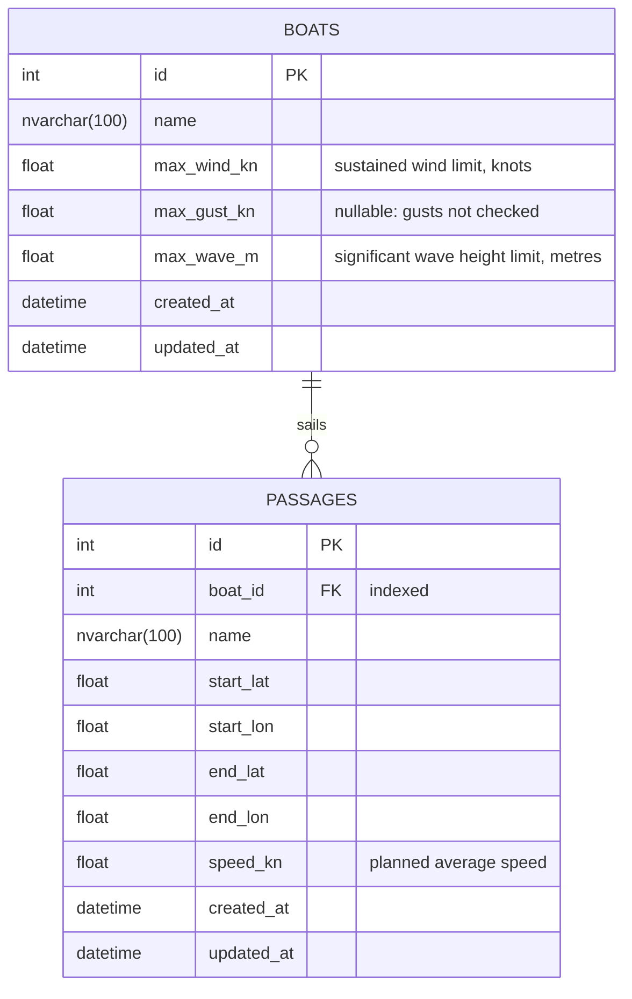
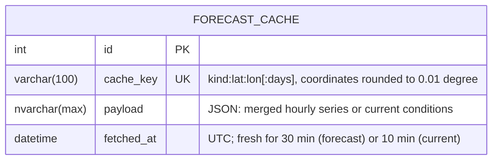

# Data model

Two databases, one per service (brief §3a). The schema is owned by the Alembic migrations, which
run on each service's startup:
`services/api/migrations/versions/0001_boats_and_passages.py` and
`services/forecast/migrations/versions/0001_forecast_cache.py`.

## API database (`sdd-3a-g<N>-api-db`)

- A boat has many passages; a passage belongs to exactly one boat.
- Deleting a boat that still has passages is refused with `409 Conflict`.
- Validation (Pydantic, `app/schemas.py`): names 1–100 characters; wind 0–80 kn; gust 0–100 kn and not
  below the wind limit; waves 0–15 m; latitude ±90; longitude ±180; speed 0–40 kn.
- Times are stored in UTC.

## Forecast database (`sdd-3a-g<N>-forecast-db`)

- No relationship to the API database: the services share data only over HTTP.
- Rows older than 7 days are deleted on write. Expired rows are still used as a stale fallback when
  Open-Meteo is down.

## Computed, not stored

The departure windows (`GET /passages/{id}/windows`) are calculated on every request from a passage,
its boat and the forecast. They are not persisted, so they are never out of date.
